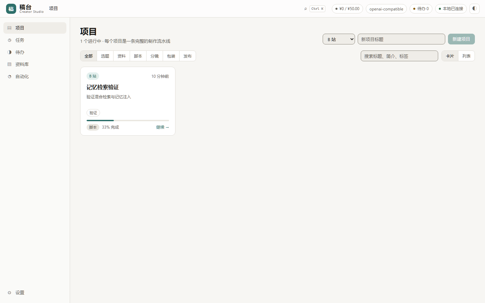
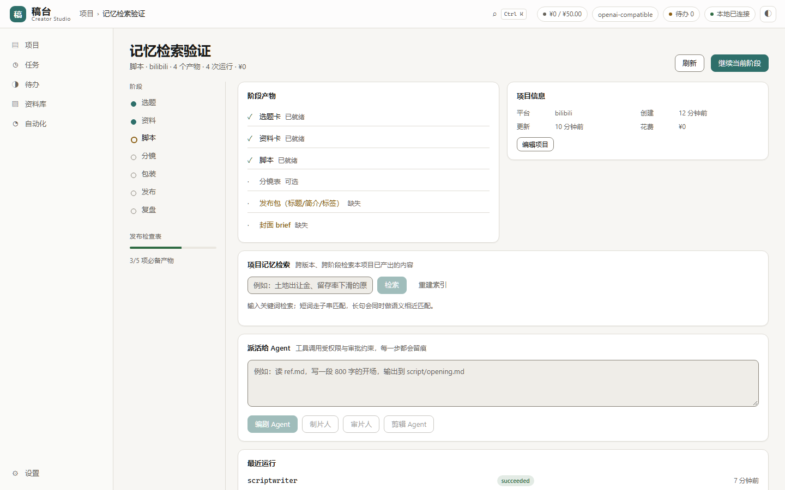
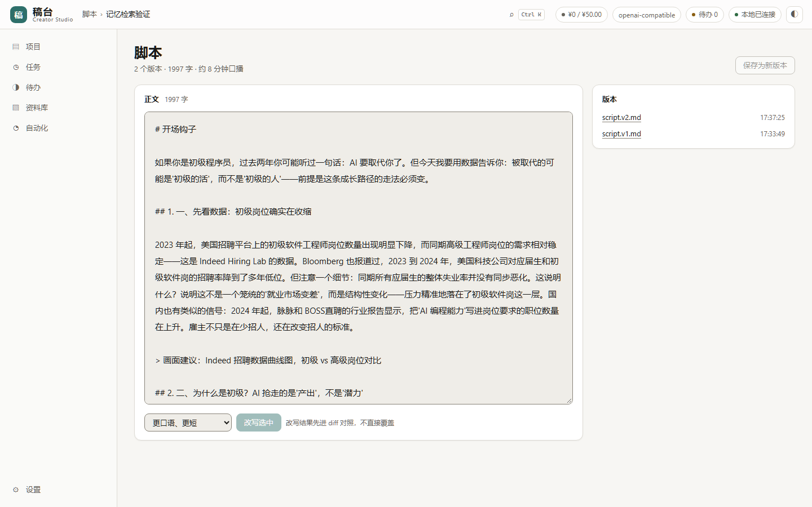
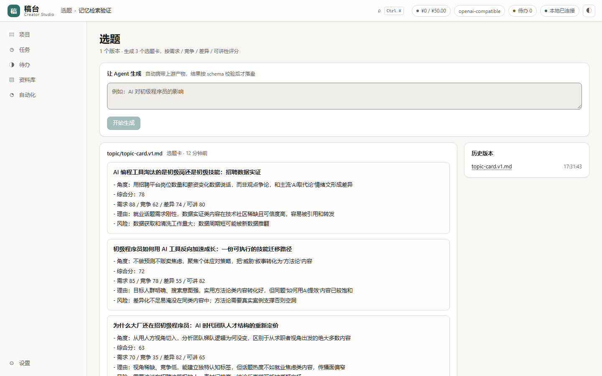
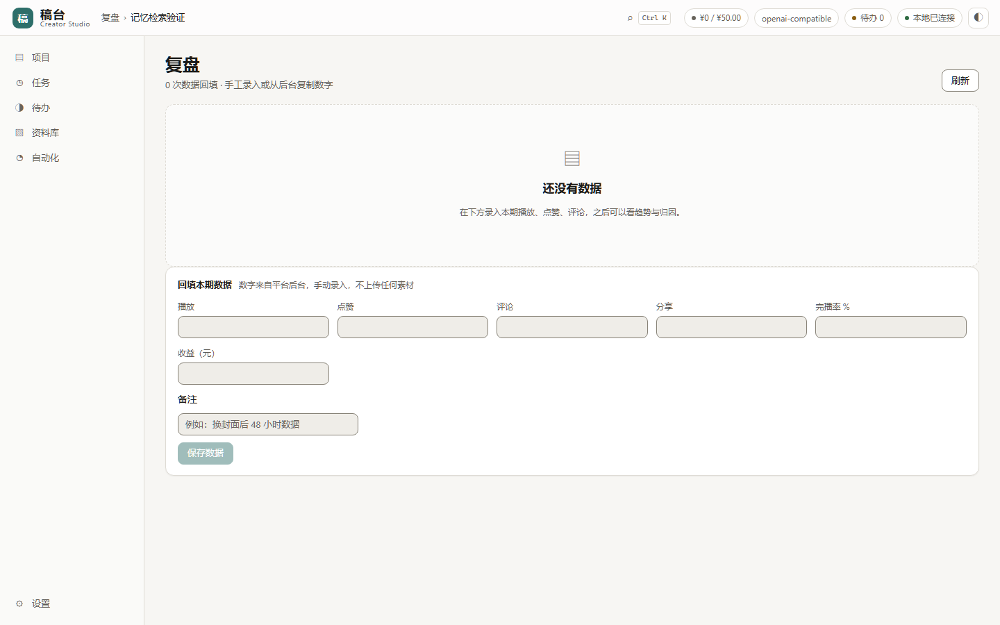
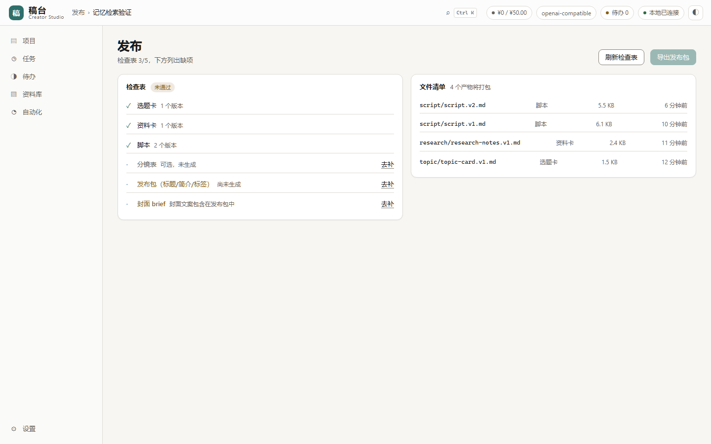
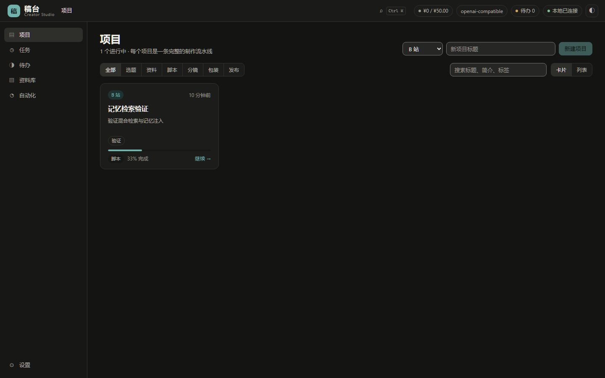

# Creator Studio (稿台)

**A local-first AI production desk for solo creators.**
One supervised, resumable, auditable pipeline: topic → research → script → shot list → packaging → publish pack → review. Your footage never leaves your machine, and you can swap the model provider at any time.

[Quick start](#quick-start) · [Screens](#screens) · [Features](#features) · [CLI](#cli) · [Architecture](#architecture) · [中文](README.md)



## The problem

A creator's toolchain is fragmented: trends from a leaderboard, research across thirty tabs, the script in a document,
the title and cover in another window, and the post-mortem from memory. General chat assistants cannot help — they have
no project context, cannot touch your files, and you re-explain everything from scratch each time.

Creator Studio treats one video as a **project** and drives it with an agent pipeline that actually reads and writes files,
calls tools, and spends within a budget — stopping at every decision that matters. It never publishes for you and never
deletes your footage on its own.

## Screens

| Workspace: stages, artifacts, checklist, dispatch | Script: edit, rewrite, diff |
|---|---|
|  |  |

| Topics: three scored cards | Review: trend and retention |
|---|---|
|  |  |

| Publish: checklist and one-click export | Dark theme |
|---|---|
|  |  |

More in [`docs/screenshots/`](docs/screenshots/) (32 shots, including 1100/900 px responsive layouts, the command palette, memory search and dark theme).
Demo recording: [`docs/media/demo.mp4`](docs/media/demo.mp4) · [`docs/media/demo.gif`](docs/media/demo.gif).

## Quick start

### 1. Desktop app

```bash
pnpm install
pnpm -r build
cd apps/desktop && pnpm tauri build
```

Output: `apps/desktop/src-tauri/target/release/bundle/nsis/CreatorStudio_0.2.0_x64-setup.exe` (11.9 MB, bundles the daemon runtime).

### 2. Browser + local daemon

```bash
pnpm install && pnpm -r build
pnpm --filter @creator-studio/daemon start -- --port 7878
# open http://127.0.0.1:7878/
```

The daemon serves the built UI itself — no separate frontend server, no CORS setup.

### 3. API / CLI only

```bash
node apps/daemon/dist/main.js --port 7878
node apps/cli/dist/main.js health
```

## Model configuration

**Through the UI (recommended)**: Settings → Models → Base URL / model / API key → save → test connection.
Secrets go to `<dataDir>/secrets.json` (mode 0600) and never into SQLite, logs, or the event stream.

**Through the environment (CI, quick trials)**:

```bash
export MODEL_BASE_URL="https://api.openai.com/v1"
export MODEL_API_KEY="sk-..."
export MODEL_NAME="gpt-4o-mini"
node apps/daemon/dist/main.js --port 7878
```

Any OpenAI-compatible endpoint works (OpenAI, DeepSeek, Qwen, Kimi, GLM, Ollama, vLLM…) plus the native Anthropic protocol.

## Features

| Feature | Detail |
|---|---|
| Seven-stage pipeline | Topic / research / script / shot list / packaging / publish / review, each with its own page and version history |
| Contract-checked artifacts | A zod contract per artifact; model output is repaired (numeric strings, scalar-to-list, nested wrappers) then validated, with one example-driven corrective retry |
| Approval gates | Delete, write-outside-workspace and shell execution require a human decision; approvals are single-use and can resume the run |
| Resumable runs | Every step's transcript is persisted; a crash marks in-flight runs `INTERRUPTED`; an approval resumes from where it stopped |
| Budget and spend | Every generation is booked as a run; monthly and per-project ceilings; live spend in the top bar |
| Tool permissions | `auto / ask / deny` per tool and path glob, deny > ask > auto, no grant means deny |
| Audit trail | Every tool call records target, decision, duration and outcome via `GET /v1/audit` |
| Publish pack | Export is gated on a green checklist; the zip contains all artifacts plus `README.md` and a `manifest.json` with per-file sha256 |
| Automations | Interval-based regeneration per project (hourly … weekly), scheduler inside the daemon, plus "run now" |
| Library | Cross-project artifact search, type filter, inline preview |
| Memory | Every artifact is chunk-indexed and searched with hybrid FTS5 substring + vector ranking; relevant history is injected into generation. Offline hash embeddings by default, switchable to a provider's `/embeddings` |
| Review | Manual views/likes/comments/retention/revenue entry with ECharts trends and period-over-period deltas |
| Multi-tenancy | Cloud storage is scoped by `userId`: cross-tenant reads/writes are 404 and logged as security events; a run targeting a foreign device degrades to a cloud-only run |
| Theming | Light / dark / system, all tokenized and contrast-checked |
| Command palette | `Ctrl/Cmd + K` to jump to projects or pages; `Ctrl+Shift+A` for approvals |

## CLI

```bash
node apps/cli/dist/main.js health
node apps/cli/dist/main.js new "Why AI is killing junior developers" --platform youtube --tag AI
node apps/cli/dist/main.js pipeline <projectId> "AI and entry-level jobs"
node apps/cli/dist/main.js publish <projectId>
```

See [`docs/CLI.md`](docs/CLI.md). The CLI speaks the same HTTP API as the UI and can target a remote daemon via `--url`.

## Architecture

```
apps/
  desktop/   React 19 + Vite + Tauri 2 (HashRouter for tauri:// and http://)
  daemon/    Fastify 5: 50 routes, SSE, static hosting, scheduler, secret vault
  cloud/     Cloud control plane (pairing / tunnel / quota / billing, in-memory)
  cli/       cs command sharing the public API
packages/
  protocol/       entity schemas, invariants, Agent Link frames, artifact contracts + coercion
  tools/          path sandbox (realpath, symlink-safe), grant evaluation, approval gate, audit, injection fence
  model-gateway/  OpenAI / Anthropic adapters, SSE parser, budget precheck, backoff, redaction
  store-sqlite/   6 migrations, 15 tables, repositories
  agent-core/     agent loop, tool feedback, approval pause/resume, transcript persistence
```

Design details: [`ARCHITECTURE.md`](ARCHITECTURE.md). HTTP surface: [`docs/API.md`](docs/API.md).

## Verification

Measured on this machine (Windows 11 / Node 24 / Rust 1.99):

```
pnpm -r test            9 packages, 421 passed
pnpm -r build           all Done
pnpm -r typecheck       all Done
node scripts/security-audit.mjs   145 files, 5 checks PASS
python scripts/check-contrast.py  all checks pass
npx tauri build         CreatorStudio_0.2.0_x64-setup.exe (11.93 MiB)
python scripts/shoot.py 25 screenshots (+7 demo shots, 32 total), 0 console errors, 0 horizontal overflow
node scripts/smoke-e2e.mjs       real-model e2e: 5 stages + checklist + zip export
```

End-to-end against a real model (not a mock): a local OpenAI-compatible gateway with `glm-5.3-flash` and
`deepseek-v4.1-flash` produced all six artifact stages, each passing schema validation; the publish pack came out at
14.6 KB with six files and a verifiable `manifest.json`.

## Comparison

Among open-source peers, Dify / n8n / langflow excel at general orchestration, OpenHands / cline at agent execution,
MoneyPrinterTurbo at one-click video generation. Creator Studio's difference is a **project-shaped seven-stage pipeline
with local-first defaults, approvals and budgets**. See [`docs/COMPETITIVE.md`](docs/COMPETITIVE.md) for the mechanism
breakdown across 15 projects with real star/license data.

## Development

```bash
pnpm install
pnpm -r test
pnpm -r typecheck
pnpm -r build
python scripts/shoot.py --base http://127.0.0.1:7878
```

- [Contributing](CONTRIBUTING.md) · [Security policy](SECURITY.md) · [Changelog](CHANGELOG.md)
- [Product notes](docs/PRODUCT-BRAINSTORM.md) · [UI spec](docs/UI-SPEC.md) · [Design system](docs/DESIGN-SYSTEM.md)

## Known limits

1. The cloud app is a single-process in-memory implementation — no Postgres/Redis yet. Multi-tenant isolation is enforced in the store with tests, but the same `WHERE user_id` predicates and RLS must be carried over when Postgres lands.
2. No auto-update (no code-signing certificate); NSIS installers upgrade manually.
3. Default memory search is **lexical vectors plus substring matching** — offline and free, not a neural semantic model. Real semantic search requires selecting an `/embeddings`-capable model in settings. The UI and the code both say so.
4. The "8 hours to 2 hours" efficiency claim is a product hypothesis, not a measured result.

## License

[MIT](LICENSE)
