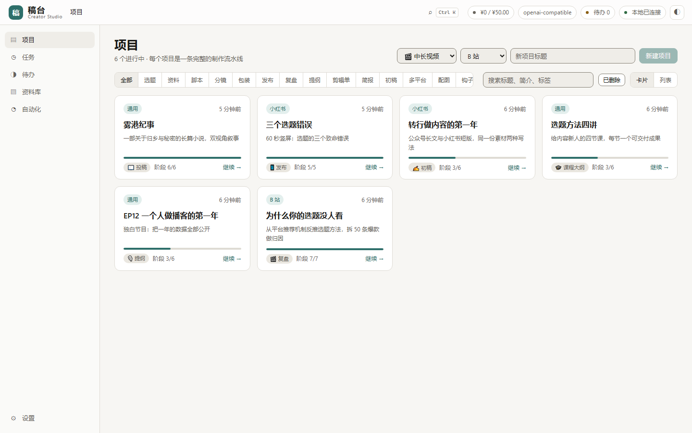
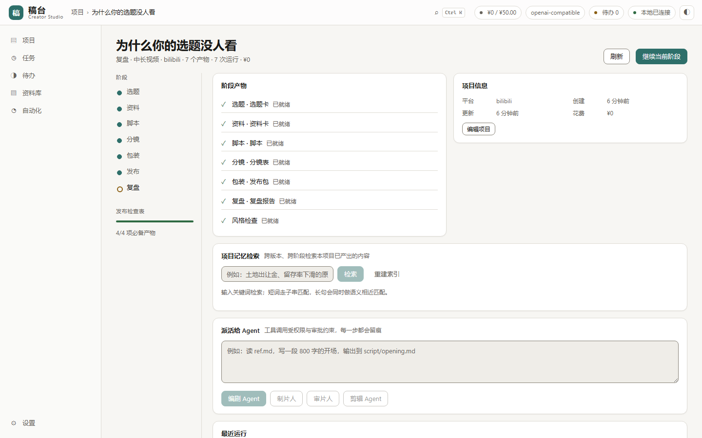
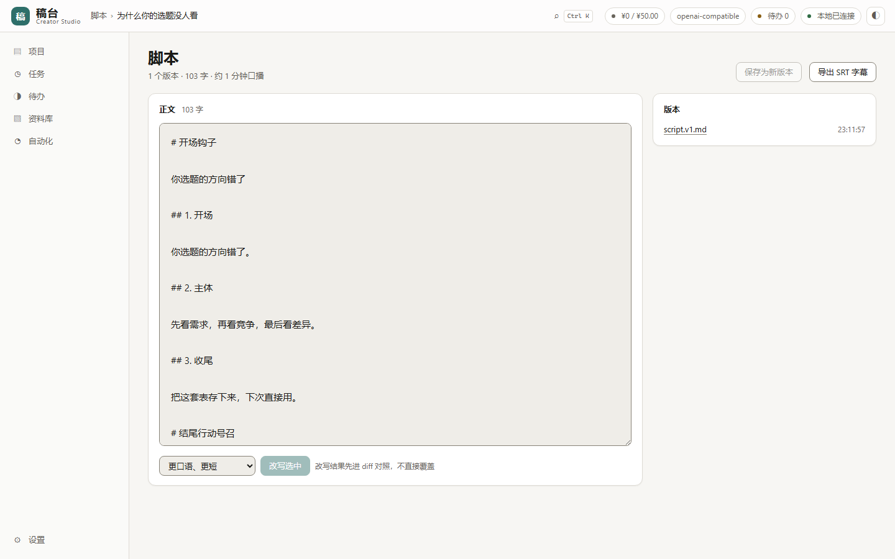
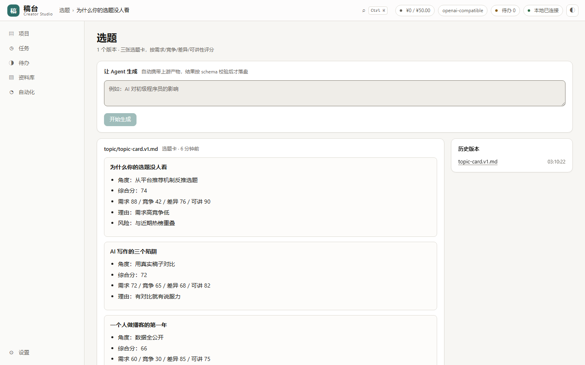
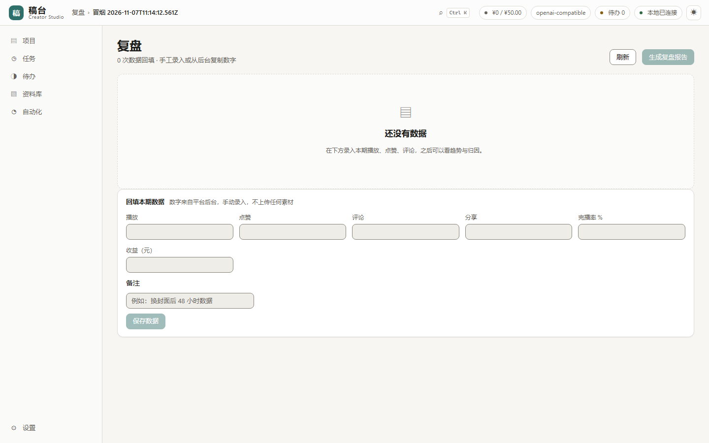
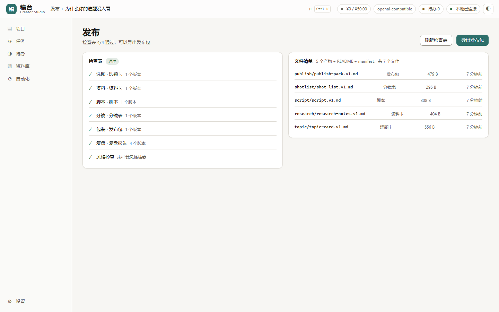
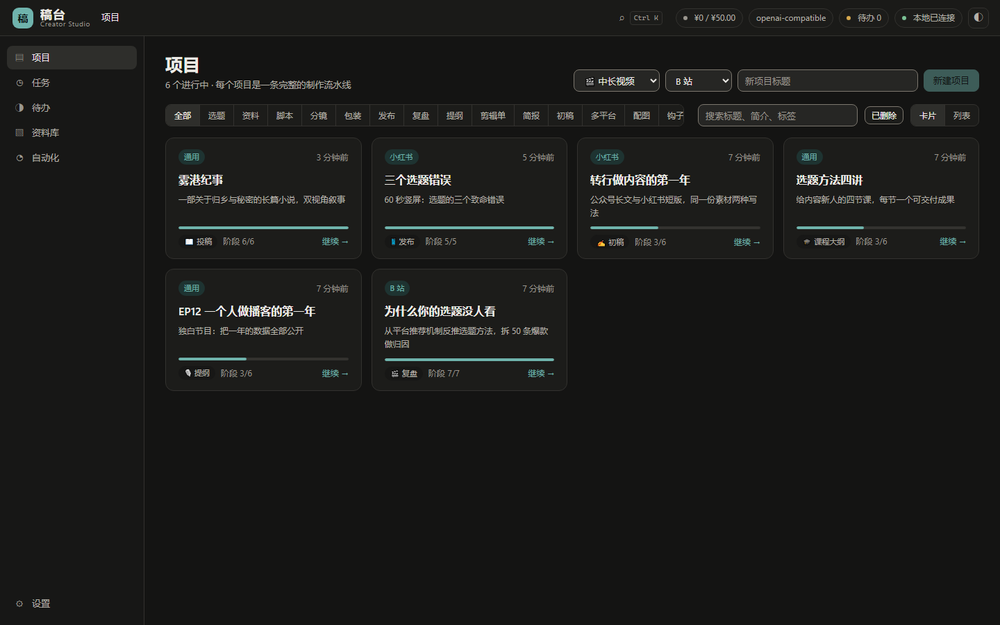

# Creator Studio

**A local-first production desk for people who ship creative work alone.**

Video, novels, podcasts, courses, long-form writing — each is a project with a
defined pipeline, versioned artifacts, and a checklist that has to go green before
anything is exported. Models run wherever you point them: a local endpoint or a
remote API. Your files never leave the machine unless you configure a remote model.

[Quick start](#quick-start) · [Screens](#screens) · [What it does](#what-it-does) · [Architecture](#architecture) · [Verification](#verification) · [中文](README.md)



---

## The problem it removes

The work is one thing; the tools are fifteen. A topic comes from a leaderboard, the
research lives in thirty tabs, the script sits in a document, the cover and title
are made somewhere else, and the post-mortem is a guess.

Creator Studio makes the project the unit. A project knows which stage it is in,
which artifacts exist, what is missing, and what has already been approved. A model
can draft each stage; you decide when a stage is done. Export is local — nothing is
uploaded to a platform on your behalf.

---

## Screens

| Workspace: stages, artifacts, checklist | Script: write and rewrite in place |
|---|---|
|  |  |

| Topics: scored candidates | Review: trends and retention |
|---|---|
|  |  |

| Publish: checklist gated export | Dark theme |
|---|---|
|  |  |

Seventy-five screenshots live in [`docs/screenshots/`](docs/screenshots/): every page
in light and dark, 1440 / 1100 / 900 px widths, the command palette, memory search,
scenario packs, the relation graph, the narrative timeline and the writing desk.
Demo recording: [`docs/media/demo.mp4`](docs/media/demo.mp4).

---

## Quick start

Three ways to run it. Pick one.

### 1. Desktop app

```bash
pnpm install
pnpm -r build
node scripts/install-daemon-deps.mjs
cd apps/desktop && pnpm tauri build
```

Output lands in `apps/desktop/src-tauri/target/release/bundle/`. The installer
bundles the daemon files but still expects Node.js ≥ 22 on `PATH` to start it.
Building requires Rust.

### 2. Browser plus a local daemon — best for development

```bash
pnpm install && pnpm -r build
pnpm --filter @creator-studio/daemon start -- --port 7878
# open http://127.0.0.1:7878/
```

The daemon serves the built UI itself. No separate front-end server, no CORS
configuration.

### 3. API or CLI only

```bash
node apps/daemon/dist/main.js --port 7878
node apps/cli/dist/main.js health
```

### Connect a model

In the app: **Settings → Models** → base URL, model name, API key → save → test.
Keys are written to `<dataDir>/secrets.json` with mode 0600 and never enter SQLite,
logs or the event stream.

Or through the environment:

```bash
export MODEL_BASE_URL="https://api.openai.com/v1"
export MODEL_API_KEY="sk-..."
export MODEL_NAME="gpt-4o-mini"
node apps/daemon/dist/main.js --port 7878
```

Both OpenAI-compatible endpoints and the native Anthropic protocol work. With a
remote model, prompts and the relevant project context are sent to that provider;
remote embeddings send the text being indexed. Check the provider's data policy
before pointing it at unpublished work.

---

## What it does

### Scenario packs: one engine, six creative jobs

A pack is JSON. It declares stages, which of six views each stage renders, the card
types with their fields, the relations between cards, and the checklist. The engine
reads packs; it never executes them.

| Pack | Stages | Cards |
|---|---|---|
| Video (mid-length) | topic · research · script · shot list · packaging · publish · review | — |
| Novel | premise · world · outline · chapters · revision · submission | character · chapter · location · foreshadow |
| Podcast | topic · research · outline · script · edit list · publish | guest · question |
| Course | goals · research · outline · lessons · exercises · launch | lesson · exercise |
| Writing | brief · material · draft · multi-platform · assets · publish | asset · persona |
| Shorts | hook · script · shots · subtitles · publish | shot |

Adding a scenario is a JSON file, not a code change. Fork a built-in pack, edit the
stages, import it. An unknown view is rejected with the list of supported ones
rather than failing at runtime.

### The six views

`generate` (artifact from a model) · `entities` (card board with optional kanban
grouping) · `document` (single-column writing desk) · `publish` (checklist-gated
export) · `review` (metrics and attribution) · `board` (drag-and-drop columns).

### Writing desk

A `document` stage becomes a chapter rail, a distraction-free editor, live word
count, a per-chapter target ring, whole-book progress and a chapter-length strip.
Autosave every 900 ms, per chapter, with chapter switching that never cross-writes.
One click exports Word (`.docx`) and Markdown.

### Narrative tools

The relation graph renders every card as a network with typed edges and inverse
labels; click a node to isolate its direct relations. The timeline lays chapters
left to right by number and draws foreshadowing threads from plant to payoff,
outlining unclosed threads in red with a list of what remains unpaid.

### Pipeline guarantees

| Concern | Behavior |
|---|---|
| Structured output | A zod contract per artifact. Model output is repaired first (numeric strings, scalar-to-list, nested wrappers), then validated, with one example-driven retry |
| Approval | Deleting, writing outside the workspace and running shell commands require a human decision. Approvals are single-use and resume the run |
| Recovery | Every step's transcript is persisted. A crash marks in-flight runs `INTERRUPTED`; an approval picks up where it stopped |
| Tool permissions | `auto / ask / deny` per tool and path glob, deny wins over ask over auto, no grant means deny |
| Audit | Every tool call records target, decision, duration and result; exportable via `GET /v1/audit` |
| Budget | Usage and cost are recorded per run; agent runs support hard budget limits |
| Provenance | Give reference URLs and the daemon fetches the real pages (private hosts, embedded credentials and non-http(s) schemes refused; robots and size limits enforced). Each fact is marked verifiable or not; unverified ones drop to low confidence, and the artifact ends with a fetch ledger and per-source sha256 |
| Memory | Every artifact is chunked and indexed; retrieval blends FTS5 substring with vector ranking. Offline feature-hash embeddings by default, switchable to a provider's `/embeddings` |
| Style | Reusable tone / audience / banned-word profiles, attached per project and injected into every generation. Banned-word hits appear in the checklist |

### Export and review

A publish pack is a ZIP built only when every required checklist item is green. It
contains the latest version of each artifact, a `README.md`, and a `manifest.json`
with a sha256 per file. Export advances the project to the published stage. Nothing
is posted to any platform.

Metrics are entered by hand (views, likes, comments, completion, revenue) and drawn
as ECharts trends with period-over-period deltas. One click then asks the model for
an attribution report, which becomes a versioned artifact and advances the project
to review.

### Everywhere

Light / dark / system themes, every color a token and every token contrast-checked.
`Ctrl/Cmd + K` command palette. Responsive down to 900 px. Subtitle export to SRT
with estimated timing that must be calibrated against the recording — the app says
so at the point of export.

---

## CLI

```bash
node apps/cli/dist/main.js health
node apps/cli/dist/main.js new "Why AI is changing junior roles" --platform youtube --tag AI
node apps/cli/dist/main.js pipeline <projectId> "AI and entry-level jobs"
node apps/cli/dist/main.js publish <projectId>
```

Full command list in [`docs/CLI.md`](docs/CLI.md). The CLI uses the same HTTP API as
the UI and can target a remote daemon with `--url`.

---

## Architecture

```
apps/
  desktop/   React 19 + Vite + Tauri 2 (HashRouter, works over tauri:// and http://)
  daemon/    Fastify 5 — 79 routes, SSE, static hosting, scheduler, secret vault
  cloud/     control plane: pairing, tunnel, quota, billing
  cli/       the `cs` command, same API as the UI
packages/
  protocol/       entity schemas, invariants, artifact contracts, output coercion
  tools/          path sandbox (realpath, symlink-safe), grants, approval gate, audit
  model-gateway/  OpenAI and Anthropic adapters, SSE parsing, budget precheck, backoff, redaction
  store-sqlite/   12 migrations, SQLite repositories
  agent-core/     agent loop, tool feedback, approval pause/resume, transcripts
```

**Design rule:** the engine owns behavior, views are a closed set of six, packs are
data. That is why a new creative job needs no new code, and why importing a pack
from someone else cannot execute their code.

Full design: [`ARCHITECTURE.md`](ARCHITECTURE.md). HTTP surface:
[`docs/API.md`](docs/API.md). Decisions: [`docs/adr/`](docs/adr/).

### Security defaults

- The daemon binds `127.0.0.1` only. CORS allows loopback and the Tauri pseudo-origin.
- Every file path goes through `resolveInsideWorkspace`, which rejects absolute
  paths, `..` and symlink escapes.
- Rendered Markdown is sanitized with DOMPurify. Model output is treated as
  untrusted input.
- API keys live in a 0600 secrets file, never in the database or the logs.
- The cloud plane ships device pairing and tunnels with revocable, rotatable device
  tokens; see "Known limits" for what is not yet proven end to end.

---

## Verification

```bash
pnpm verify          # lint → build → typecheck → test → offline smoke → security → contrast → version agreement
pnpm -r test         # 657 passed, 0 skipped
pnpm test:postgres   # tenant isolation against a real database (opt-in)
```

UI changes additionally require a real browser:

```bash
python scripts/shoot.py --base http://127.0.0.1:7878         # 26 pages, layout assertions
python scripts/click-sweep.py --base http://127.0.0.1:7878   # every control, keyboard nav
```

What each layer proves, and what it cannot, is written down in
[`docs/VERIFICATION.md`](docs/VERIFICATION.md). Current state, including what is
**not** verified, is in [`docs/STATUS.md`](docs/STATUS.md). The short version:

| Proven | Not proven |
|---|---|
| Unit, contract and store tests; offline model contract; security and contrast audits; browser layout and interaction sweeps; the full artifact pipeline against a local model stub | Live vendor accounts, macOS/Linux installers, the auto-update round trip, Postgres under load, the desktop→cloud execution chain, any human time-saving figure |

No time-saving number is published anywhere in this repository, because none has
been measured.

---

## How it differs

Dify, n8n and langflow are general orchestration. OpenHands and cline are agent
execution environments. MoneyPrinterTurbo is one-click video generation. Creator
Studio is narrower: a project with a scenario-defined pipeline, local-first storage,
approval-gated tools, and artifact contracts that make model output reproducible.

A mechanism-by-mechanism comparison against fifteen projects, with the gaps left
open, is in [`docs/COMPETITIVE.md`](docs/COMPETITIVE.md).

---

## Known limits

Stated here so you find them before a deadline does.

1. **Chapter autosave overwrites the whole body.** Two clients on one chapter will
   overwrite each other; single-user is safe. §0.19 in the roadmap.
2. **The writing desk is plain Markdown.** No comments, tracked changes or table of
   contents; complex layout belongs in the exported Word file.
3. **Default memory retrieval is lexical**, an n-gram feature hash plus substring
   match, not a neural embedding model. True semantic retrieval requires a provider
   that serves `/embeddings`, and the UI says so where you choose.
4. **Subtitle timing is estimated** from punctuation and text length. It is not
   aligned to audio; calibrate against the recording.
5. **The cloud plane is not proven end to end.** Pairing, tunnels, quotas and
   tenant isolation exist and the Postgres predicates are in SQL, but a
   desktop→cloud task has never been executed.
6. **Auto-update is wired but unproven.** Signing and the updater plugin are in
   place; a real old→new upgrade has not been performed. Windows installers are not
   code-signed, so SmartScreen will warn.
7. **No timed study exists.** Any productivity claim you read elsewhere about this
   kind of tool does not come from this project.

---

## Development

```bash
pnpm install
pnpm verify            # the whole gate; this is what CI runs
pnpm -r test           # 657 passed, 0 skipped
```

Two harnesses make a full run reproducible without credentials:

```bash
node scripts/stub-model.mjs 7996            # deterministic OpenAI-compatible stub
node scripts/seed-demo.mjs http://127.0.0.1:7878   # presentable demo dataset
```

- Contributing: [`CONTRIBUTING.md`](CONTRIBUTING.md)
- Security policy: [`SECURITY.md`](SECURITY.md)
- Code of conduct: [`CODE_OF_CONDUCT.md`](CODE_OF_CONDUCT.md)
- Changelog: [`CHANGELOG.en.md`](CHANGELOG.en.md)
- Release process: [`docs/RELEASING.md`](docs/RELEASING.md)
- Architecture: [`ARCHITECTURE.md`](ARCHITECTURE.md)
- API reference: [`docs/API.md`](docs/API.md)
- UI specification: [`docs/UI-SPEC.md`](docs/UI-SPEC.md) · Design system: [`docs/DESIGN-SYSTEM.md`](docs/DESIGN-SYSTEM.md)

## Try it with a novel

```bash
# A novel project: stage order comes from the pack
curl -s -X POST http://127.0.0.1:7878/v1/projects \
  -H 'content-type: application/json' \
  -d '{"title":"Harbor of Fog","scenarioId":"novel"}'
```

```bash
# A character card. Fields are declared by the novel pack; a missing required
# field is rejected. Select fields must use a declared option, so the value below
# is the pack's own label for the protagonist role.
curl -s -X POST http://127.0.0.1:7878/v1/projects/<projectId>/entities \
  -H 'content-type: application/json' \
  -d '{"type":"character","title":"Lin Yan","fields":{"name":"Lin Yan","role":"主角","goal":"Find out what happened to his father"}}'
```

In the UI: the scenario badge on the project card → the workspace shows that pack's
stages → "open cards" goes to characters, chapters, locations and foreshadowing.

## Writing your own scenario

A pack is data. Declare stages, the view each one renders, card types with their
fields, and the checklist:

```json
POST /v1/scenarios
{
  "id": "screenplay",
  "name": "Screenplay",
  "stages": [
    { "key": "logline", "label": "Logline", "view": "generate", "produces": ["topic-card"], "required": true },
    { "key": "scene",   "label": "Scenes",  "view": "entities", "entityType": "scene", "produces": ["chapter"], "required": true }
  ],
  "entityTypes": [
    { "key": "scene", "label": "Scene", "titleField": "slug", "fields": [
      { "key": "slug", "label": "Scene number", "type": "text", "required": true }
    ]}
  ]
}
```

`inherits` lets a pack extend a built-in without repeating it: a child pack writes
only its additions, same-key stages override, depth is capped at 4 and cycles are
rejected.

## License

[MIT](LICENSE)
