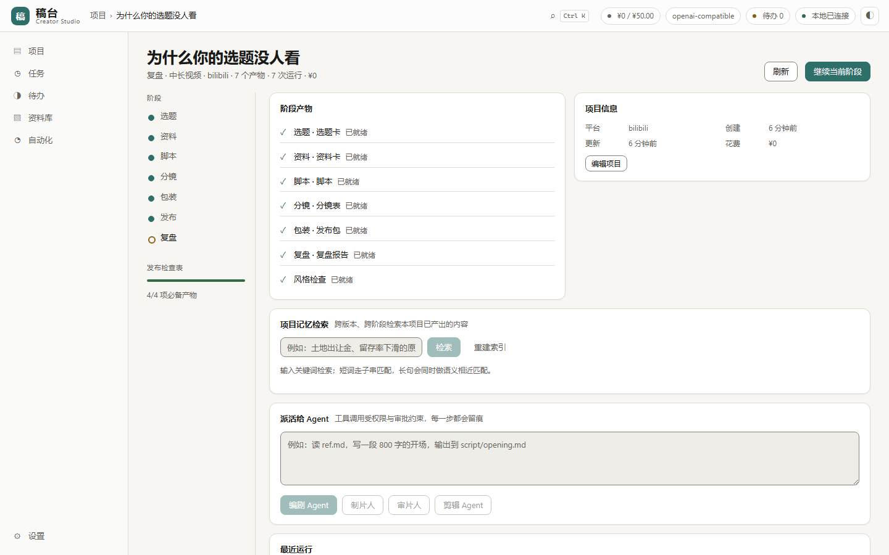
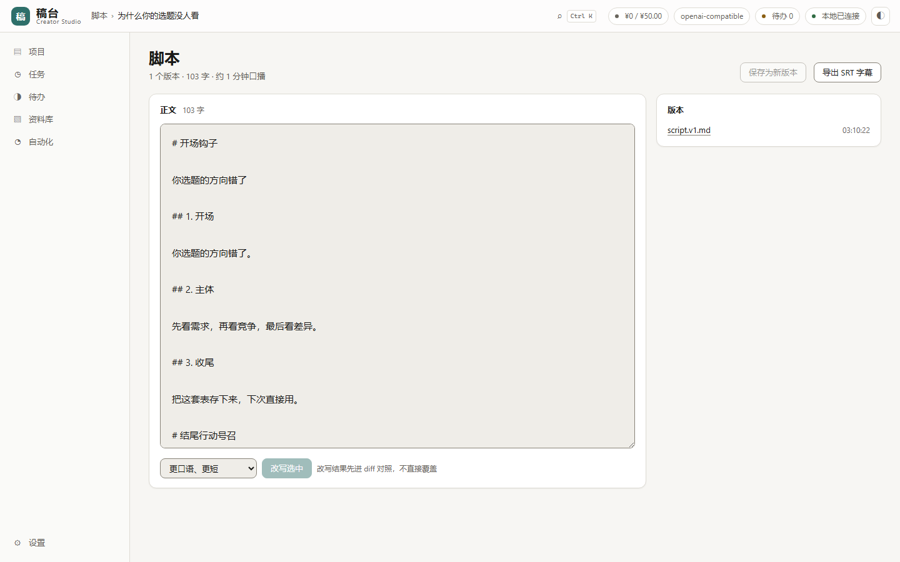
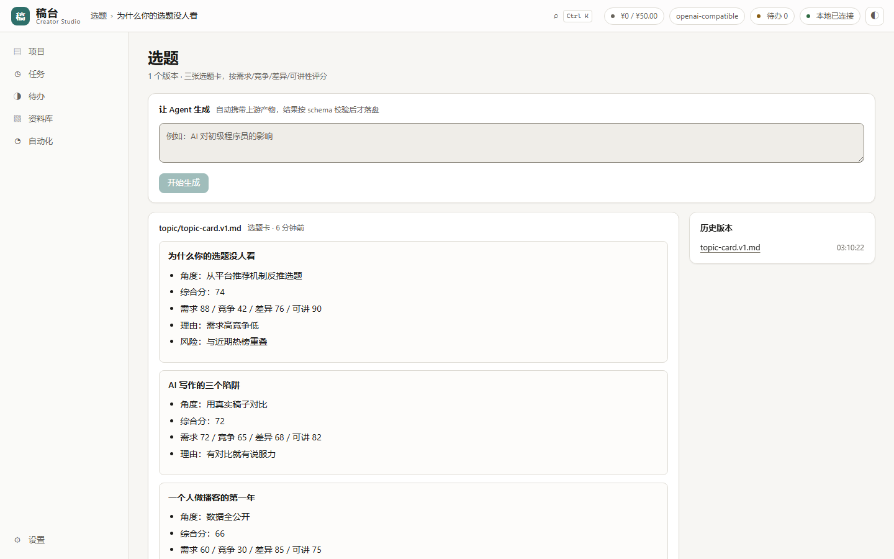
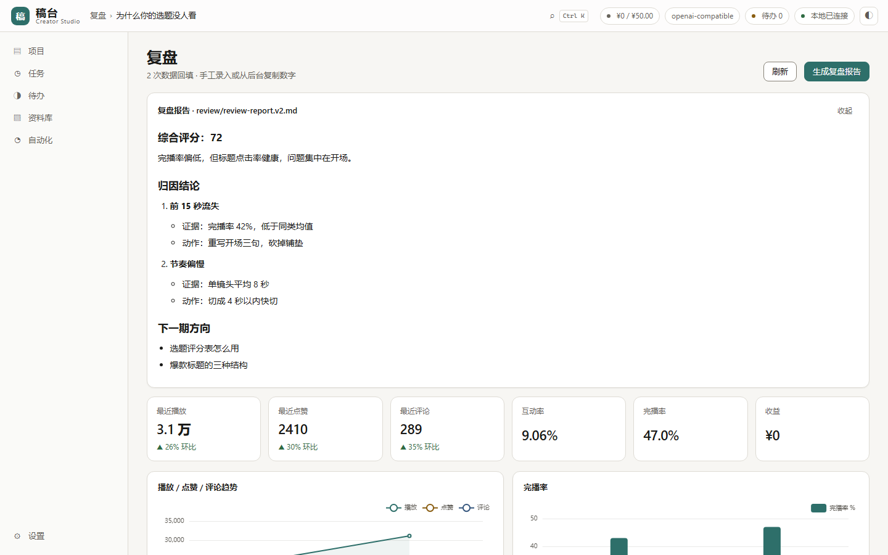
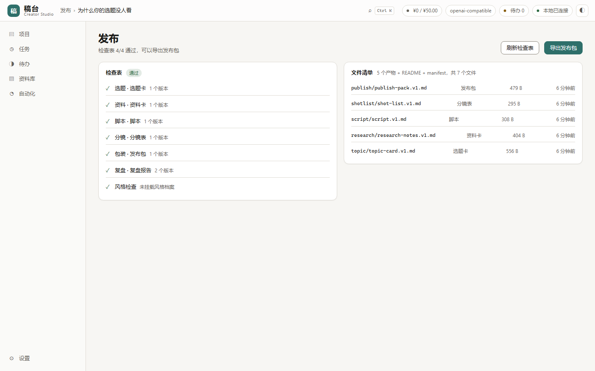
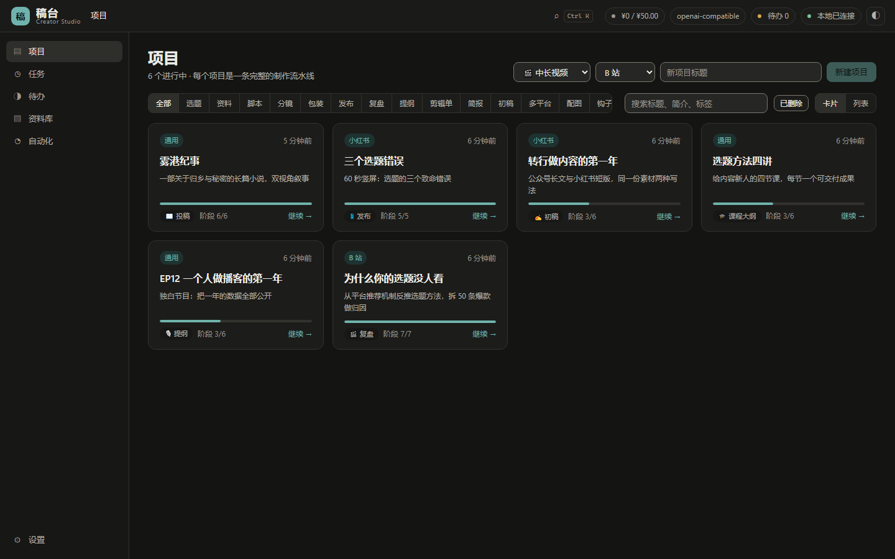

# 稿台 Creator Studio

[](https://github.com/Morningstar202604/creator-studio/actions/workflows/ci.yml)
[](LICENSE)
[](package.json)

**给一个人独立交付作品的本地优先创作台。**

视频、小说、播客、课程、长文、短视频——六种创作活，每一样都是一个项目：有既定流水线、
带版本的产物，以及一份必须全绿才能导出的检查表。模型指向哪里由你决定，文件留在本机。

[快速开始](#快速开始) · [怎么运作](#怎么运作) · [界面](#界面) · [架构](#架构) · [English](README.en.md)

---

## 怎么运作

```
                    ┌──────────────────────────────────────────┐
   你               │  一个项目                                 │
   ────┐            │                                          │
       │            │  场景包（JSON）                           │
       └───────────▶│    ├ 阶段：选题 → 资料 → 脚本 …            │
                    │    ├ 视图： generate / entities /         │
                    │    │        document / board / publish /  │
                    │    │        review                        │
                    │    └ 检查表：导出前必须存在什么            │
                    │                                          │
                    │  产物（带版本、sha256、契约校验）          │
                    │  卡片（角色、章节、镜头 …）                │
                    └───────────────┬──────────────────────────┘
                                    │
              ┌─────────────────────┼─────────────────────┐
              ▼                     ▼                     ▼
        ┌──────────┐         ┌────────────┐        ┌──────────┐
        │ 桌面端    │         │   daemon   │        │   CLI    │
        │ (Tauri)  │◀───────▶│ (Fastify)  │◀──────▶│   (cs)   │
        └──────────┘  HTTP   └─────┬──────┘  HTTP  └──────────┘
                                   │
                        ┌──────────┴──────────┐
                        ▼                     ▼
                 ┌────────────┐        ┌─────────────┐
                 │  SQLite    │        │   工作区     │
                 │ 运行、产物、 │        │  真实文件，   │
                 │ 卡片        │        │  沙箱在一个   │
                 │            │        │  目录内       │
                 └────────────┘        └─────────────┘
```

**场景包是数据，不是代码**：阶段、视图、卡片字段、关系与检查表都写在 JSON 里。
新增一种创作活是写一份场景包，不是改引擎。其余设计都从这一条推出来。

## 你能得到什么

| | |
|---|---|
| **六套场景包** | 中长视频（7 阶段）· 长篇小说（6 阶段，角色/章节/伏笔卡）· 播客 · 课程 · 文案 · 短视频 |
| **六个视图** | `generate` · `entities`（看板）· `document`（写作台）· `board` · `publish` · `review` |
| **契约校验的输出** | 每类产物过 zod 契约；模型输出先矫正、失败带示例重试一次，仍不合格就拒绝——绝不静默写入 |
| **审批门** | 删除、写工作区外、执行命令必须人工批准。一次批准只用一次 |
| **可恢复** | 每步转录落盘；崩溃把运行标为 `INTERRUPTED`；批准后从断点续跑 |
| **溯源** | 给链接就真抓原文（私网与非 http(s) 拒绝、遵守 robots）。每条事实标注是否可核，附抓取记录与 sha256 |
| **本地导出** | ZIP 内含每类产物最新版、一份 README、逐文件 sha256 的 `manifest.json`。不向任何平台上传 |

## 界面

| 工作台 | 写作台 |
|---|---|
|  |  |

| 选题卡，带评分 | 复盘，带趋势 |
|---|---|
|  |  |

| 发布，检查表卡住导出 | 深色主题 |
|---|---|
|  |  |

[`docs/screenshots/`](docs/screenshots/) 有 76 张：每个页面明暗两套，1440 / 1100 /
900 三档宽度。演示录屏：[`docs/media/demo.mp4`](docs/media/demo.mp4)。

## 快速开始

**桌面端**（构建需要 Node ≥ 22 与 Rust）：

```bash
pnpm install && pnpm -r build && node scripts/install-daemon-deps.mjs
cd apps/desktop && pnpm tauri build
```

**浏览器 + 本地 daemon** —— 开发时最快：

```bash
pnpm install && pnpm -r build
pnpm --filter @creator-studio/daemon start -- --port 7878
# 打开 http://127.0.0.1:7878/
```

**只要 CLI**：

```bash
node apps/daemon/dist/main.js --port 7878 &
node apps/cli/dist/main.js health
```

然后在**设置 → 模型**里填 Base URL、模型名、API Key（密钥写入
`<dataDir>/secrets.json`，权限 0600），或设置 `MODEL_BASE_URL` / `MODEL_API_KEY` /
`MODEL_NAME`。OpenAI 兼容端点与 Anthropic 原生协议都支持。

## 架构

| 包 | 职责 |
|---|---|
| `apps/daemon` | 唯一的写入方。Fastify、SQLite、SSE、调度器、密钥库 |
| `apps/desktop` | React 19 + Vite + Tauri 2。按视图思考，不按页面 |
| `apps/cli` | 21 条命令，走同一套 HTTP API |
| `packages/protocol` | schema、不变量、产物契约、输出矫正 |
| `packages/tools` | 路径沙箱（realpath、防符号链接）、授权、审批门、审计、MCP 风格工具注解 |
| `packages/model-gateway` | OpenAI / Anthropic 适配器、SSE 解析、预算预检、退避、脱敏 |
| `packages/store-sqlite` | 13 个迁移、仓储 |
| `packages/agent-core` | Agent 循环、工具回灌、暂停与恢复、转录落盘 |

完整设计见 [`ARCHITECTURE.md`](ARCHITECTURE.md)。Agent 协议那部分——我们在 MCP /
A2A / AG-UI 上实现了什么、刻意不做什么——见
[`docs/AGENT-HARNESS.md`](docs/AGENT-HARNESS.md)。

### 安全默认值

daemon 只绑 `127.0.0.1`。所有路径经 `resolveInsideWorkspace`（拒绝绝对路径、`..`、
符号链接逃逸）。Markdown 一律经 DOMPurify 消毒。模型输出视为不可信输入。
密钥不进 SQLite、不进日志。

## 验证

```bash
pnpm verify     # lint → build → typecheck → 测试 → 冒烟 → 安全 → 对比度 → 版本 → Postgres
```

662 项测试，**0 跳过**。Postgres 套件自己起一个临时集群、跑完自动关闭，
所以那九个租户隔离测试原来跳过，现在真的在跑。

每一层能证明什么、不能证明什么写在
[`docs/VERIFICATION.md`](docs/VERIFICATION.md)。当前状态（包括**未**验证项）在
[`docs/STATUS.md`](docs/STATUS.md)。简版：

| 已验证 | 未验证 |
|---|---|
| 单元、契约与存储测试；离线模型契约；安全与对比度审计；浏览器布局与交互巡检；对本地模型桩的完整产物链路；九个 Postgres 租户隔离测试对真实集群 | 真实厂商账号、macOS/Linux 安装包、自动更新往返、Postgres 压测、桌面→云端执行链、任何省时数字 |

本仓库不发布任何省时数字，因为没有测过。

## 已知边界

1. **章节自动保存整章覆盖**：同一章两个客户端会互相覆盖，单人使用安全。
2. **写作台是纯 Markdown**：没有批注与修订模式；复杂版式交给导出的 Word。
3. **默认记忆检索是词法的**（n-gram 特征哈希 + 子串），不是神经模型。
   指向支持 `/embeddings` 的服务商才是真语义检索。
4. **字幕时间是估算的**：按标点与长度推算，需按录音校准。
5. **daemon 没有鉴权**：只绑回环，信任本机用户。
6. **自动更新接线未验证**：一次真实的旧版→新版升级从未做过。

## 开发

```bash
pnpm verify                                          # 全部门禁，与 CI 一致
node scripts/stub-model.mjs 7996                     # 确定性的模型桩
node scripts/seed-demo.mjs http://127.0.0.1:7878     # 可展示的演示数据
python scripts/shoot.py --base http://127.0.0.1:7878 # 27 页，布局断言
python scripts/click-sweep.py --base http://127.0.0.1:7878  # 每个控件
```

- Agent 指引：[`AGENTS.md`](AGENTS.md)
- 贡献：[`CONTRIBUTING.md`](CONTRIBUTING.md) · 行为准则：[`CODE_OF_CONDUCT.md`](CODE_OF_CONDUCT.md)
- 变更记录：[`CHANGELOG.md`](CHANGELOG.md) · 发布流程：[`docs/RELEASING.md`](docs/RELEASING.md)
- 路线图：[`docs/ROADMAP.md`](docs/ROADMAP.md) · 接口：[`docs/API.md`](docs/API.md)

## 许可证

[MIT](LICENSE)
