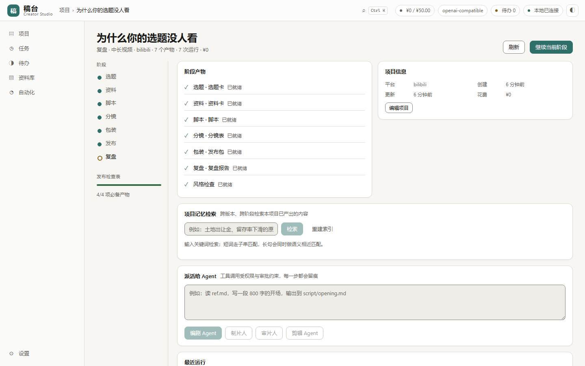
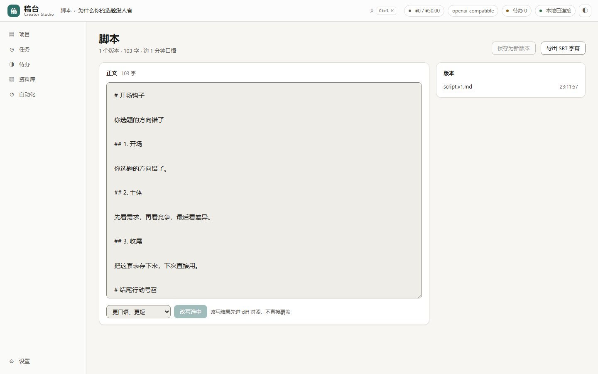
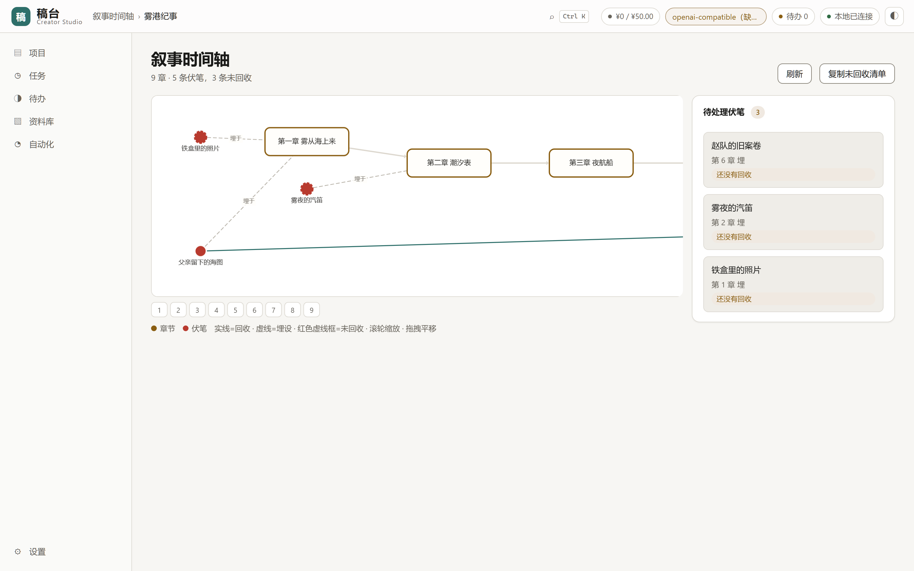
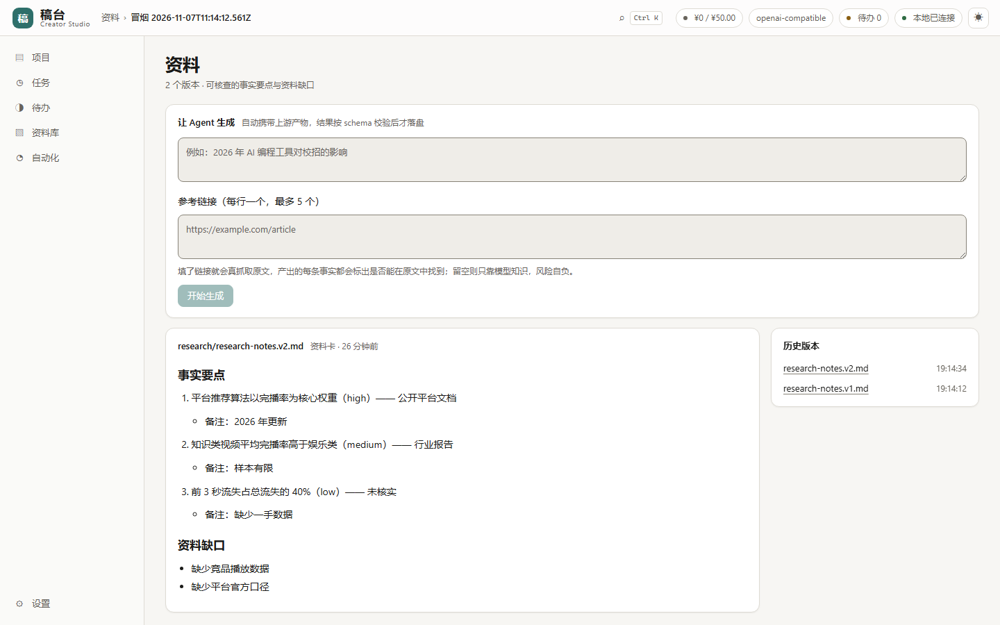
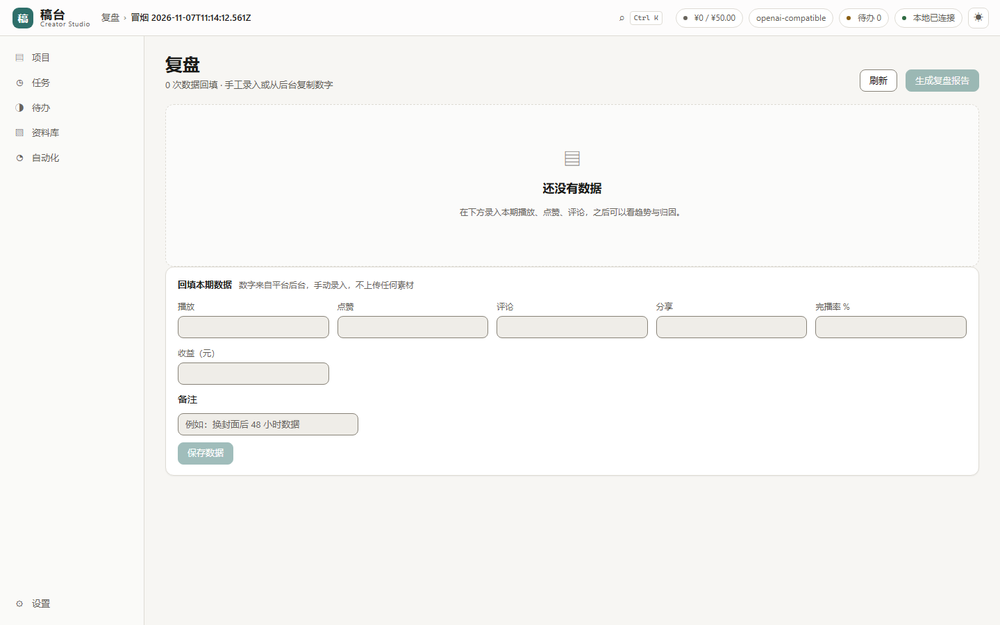

<p align="center">
  
</p>

<h1 align="center">稿台 Creator Studio</h1>

<p align="center">把一个想法做成成品视频、小说或播客——流程、文件与版本都放在一个地方。</p>

<p align="center">
  
  
  
</p>

<p align="center">
  <a href="https://github.com/Morningstar202604/creator-studio/releases/latest"><strong>下载 Windows 版 →</strong></a>
  &nbsp;·&nbsp;
  <a href="README.en.md">English</a>
</p>



## 安装

从 [Releases](https://github.com/Morningstar202604/creator-studio/releases/latest) 下载 `CreatorStudio_0.18.0_x64-setup.exe` 直接运行。需要系统里有 Node.js 22 或更高版本。

或者从源码跑：

```bash
pnpm install && pnpm -r build
pnpm --filter @creator-studio/daemon start -- --port 7878
# 打开 http://127.0.0.1:7878/
```

两种方式都要在**设置 → 模型**里填一个 Key。OpenAI 兼容端点与 Anthropic 都支持。Key 只留在本机文件里，不进数据库、不进日志。

## 能做什么

选一个场景，每个场景是一条流水线，有自己的阶段、文件和检查表。

| 场景 | 流水线 |
|---|---|
| **中长视频** | 选题 → 资料 → 脚本 → 分镜 → 包装 → 发布 → 复盘 |
| **长篇小说** | 设定 → 世界观 → 大纲 → 章节 → 修订 → 投稿 |
| **播客** | 选题 → 资料 → 提纲 → 逐字稿 → 剪辑单 → 发布 |
| **课程** | 目标 → 调研 → 大纲 → 课时 → 练习 → 上线 |
| **文案** | 简报 → 素材 → 初稿 → 多平台 → 配图 → 发布 |
| **短视频** | 钩子 → 口播稿 → 镜头 → 字幕 → 发布 |

小说流水线的实际样子——章节、角色、伏笔，以及一条能看出哪些线还没收回的时间轴：

| 写作台 | 叙事时间轴 |
|---|---|
|  |  |

| 卡片与关系 | 复盘与趋势 |
|---|---|
|  |  |

每一步都会在项目目录里写一个带版本的文件。除非你把模型指向远程端点，否则内容不出本机。

## 为什么产出能用

模型输出先过 schema 才落盘。如果模型把 `"score": "88"` 写成字符串，会被矫正；如果返回的是散文而不是 JSON，会带一个示例重试一次；还是不行就报错并说清哪一项不合格——不会写一个半成品文件。

另外两件日常会用到的：

- **破坏性操作先问。** 删文件、写项目外、执行命令都会停下来等你批准。一次批准只覆盖一次操作。
- **崩了能接上。** 每一步都落盘。应用中途挂掉，那次运行会被标为中断，之后从断点继续。

## 命令行

```bash
cs health
cs new "为什么你的选题没人看" --platform bilibili
cs gen <projectId> script "关于选题的开场钩子"
cs publish <projectId>
```

21 条命令，和界面走同一套 API。加 `--url` 可以驱动另一台机器上的 daemon。

## 截图

<details>
<summary>全部 76 张</summary>

[`docs/screenshots/`](docs/screenshots/) 里 76 张，明暗两套，1440 / 1100 / 900 三档宽度。

演示录屏：[`docs/media/demo.mp4`](docs/media/demo.mp4)。

</details>

## 状态

674 项测试，0 跳过。其中包含九个对真实 Postgres 集群跑的租户隔离测试、27 个页面的真浏览器巡检（0 控制台错误、0 布局溢出），以及一次对本地模型桩的完整流水线跑通。

| 已经能用 | 还没做 |
|---|---|
| 六条流水线全链路、文件版本、审批门、断点续跑、本地导出、字幕导出、复盘闭环 | 真实厂商模型未进 CI；macOS / Linux 安装包未构建；自动更新未做真实往返 |

已知边界写在 [`docs/STATUS.md`](docs/STATUS.md)。本仓库不写省时数字，因为没有测过。

## 开发

```bash
pnpm verify                                          # lint → build → test → audit → Postgres
node scripts/stub-model.mjs 7996                     # 确定性的模型桩
python scripts/shoot.py --base http://127.0.0.1:7878 # 截图 + 布局断言
```

[`AGENTS.md`](AGENTS.md) 里有 agent 需要的命令与规则。[`docs/AGENT-HARNESS.md`](docs/AGENT-HARNESS.md) 讲我们在 MCP / A2A / AG-UI 上实现了什么。

## 许可证

MIT
