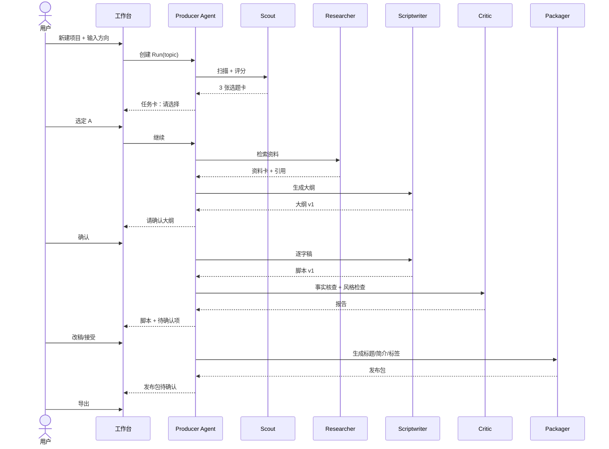

# 界面与使用逻辑规格（UI Spec）

> 配套 `../ARCHITECTURE.md`。本文定义「有哪些界面、怎么分布、用户怎么走」，是前端实施的依据。
> 状态：v0.2 已实施。线框仍是结构示意；实际界面见 `docs/screenshots/`。

## 1. 设计原则

1. **任务优先，聊天其次**：首页看到的是「项目推进到哪」，不是对话框。
2. **一个项目一个工作台**：所有阶段、产物、对话都收在项目内，不跨页面找东西。
3. **全局只有三个常驻区**：左侧导航、中间工作区、右侧检查器。任何新功能必须落进这三区之一，不新开浮层。
4. **审批不藏在弹窗里**：需要人决定的事进入「待办」，永久可查，不因为关掉弹窗而丢失。
5. **状态永远可见**：本地/云端、模型、预算、设备在线状态在顶栏常驻，用户随时知道「现在是谁在干活、花谁的钱」。
6. **失败可解释**：任何红色状态必须给出「哪一步、为什么、下一步」，不允许只显示「出错了」。

## 2. 布局模型

```
┌──────────────────────────────────────────────────────────────────────────┐
│ 顶栏：项目名 · 阶段 · 模式徽标(本地/云端) · 模型 · 预算 · 设备 · 搜索 · 头像 │
├──────────┬───────────────────────────────────────────────┬───────────────┤
│ 左导航   │  主工作区                                      │ 右检查器      │
│ 220px    │  自适应                                        │ 320–420px     │
│          │                                               │ 可折叠        │
│ 项目     │  页面内容（看板/编辑/列表）                     │ 任务详情/      │
│ 任务     │                                               │ 引用来源/      │
│ 待办     │                                               │ 版本对比/      │
│ 资料库   │                                               │ Agent 对话     │
│ 自动化   │                                               │               │
│ 设置     │                                               │               │
├──────────┴───────────────────────────────────────────────┴───────────────┤
│ 底栏（可选）：当前 Run 进度条 · 步骤 3/7 · 已用 ¥0.42 · 暂停/取消          │
└──────────────────────────────────────────────────────────────────────────┘
```

- 最小窗口 1100×700；小于 1100px 时右检查器变为抽屉。
- 左导航可收成 56px 图标栏，状态持久化。
- 底栏只在有运行中任务时出现，避免常驻占位。

## 3. 信息架构

```
启动
├─ 首次引导（仅一次）
│  ├─ 选择模型（API Key / 本地 Ollama / 稍后）
│  ├─ 选择工作区目录
│  └─ 导入已有项目（可选）
├─ 主页 / 项目
│  ├─ 项目列表（卡片 / 表格）
│  └─ 新建项目
├─ 项目工作台  /p/:id
│  ├─ 概览
│  ├─ 选题
│  ├─ 资料
│  ├─ 脚本
│  ├─ 分镜
│  ├─ 包装
│  ├─ 发布
│  └─ 复盘
├─ 任务  /runs           （全局 Run 列表与筛选）
├─ 待办  /approvals      （所有等待人工决定的项）
├─ 资料库 /library       （跨项目素材与资料卡）
├─ 自动化 /automations   （定时任务、云端任务）
├─ 设置 /settings
│  ├─ 模型
│  ├─ 设备与连接
│  ├─ 权限
│  ├─ 预算
│  ├─ 存储与隐私
│  └─ 关于/更新
└─ 云端控制台（Web，独立）
   ├─ 项目（只读）
   ├─ 运行记录
   ├─ 设备
   └─ 账单
```

## 4. 页面清单

| ID | 页面 | 路由 | 目的 | 关键元素 | 必须处理的状态 | 阶段 |
|---|---|---|---|---|---|---|
| P0 | 首次引导 | `/onboarding` | 3 步完成可用配置 | 模型选择、目录选择、连通性测试 | 无 Key、无网络、目录不可写 | MVP |
| P1 | 项目列表 | `/` | 找到/新建项目 | 卡片、阶段标签、最近活动、搜索 | 空、加载、失败 | MVP |
| P2 | 项目工作台 | `/p/:id` | 推进单个视频 | 阶段条、当前阶段内容、右侧任务 | 各阶段空态、Agent 运行中 | MVP |
| P3 | 选题页 | `/p/:id/topic` | 生成并拍板选题 | 选题卡列表、评分雷达、竞品对照 | 无候选、评分中、已定稿 | MVP |
| P4 | 资料页 | `/p/:id/research` | 管理资料与引用 | 资料卡、来源列表、引用插入 | 抓取失败、重复、失效链接 | MVP |
| P5 | 脚本页 | `/p/:id/script` | 写稿与改稿 | 双栏编辑器、版本、diff、事实核查标记 | 版本冲突、核查中、被拒 | MVP |
| P6 | 分镜页 | `/p/:id/shotlist` | 镜头清单 | 分镜表、景别/画面/B-roll/上屏字幕/时长 | 未生成、生成失败 | MVP（v0.2 落地） |
| P7 | 包装页 | `/p/:id/package` | 标题封面发布包 | 标题候选+评分、封面 brief、平台预览 | 生成中、超限、合规警告 | MVP |
| P8 | 发布页 | `/p/:id/publish` | 导出与发布确认 | 文件清单、检查表、复制/导出 | 缺文件、平台未选 | MVP |
| P9 | 复盘页 | `/p/:id/review` | 数据回填与归因 | 指标卡、趋势图、完播率、环比、历史记录 | 无数据、录入非法 | MVP（v0.2 落地） |
| P10 | 任务列表 | `/runs` | 看所有运行 | 表格、状态、耗时、花费、筛选 | 空、运行中、失败 | MVP |
| P11 | 待办 | `/approvals` | 处理人工确认 | 审批卡、上下文预览、批准/拒绝 | 过期、批量、危险操作强调 | MVP |
| P12 | 资料库 | `/library` | 跨项目产物 | 列表、类型筛选、搜索、预览 | 空、加载失败 | MVP（v0.2 落地） |
| P13 | 自动化 | `/automations` | 定时生成 | 规则、下次运行、开关、立即运行、最近执行 | 未配模型、执行失败 | MVP（v0.2 落地） |
| P14 | 设置-模型 | `/settings/models` | 配模型 | Provider 卡片、Key 输入、测试连接、价格 | 无效 Key、超时、限流 | MVP |
| P15 | 设置-设备 | `/settings/devices` | 管理设备与连接 | 当前设备、配对码、在线状态、吊销 | 配对过期、离线 | P1 |
| P16 | 设置-权限 | `/settings/permissions` | 工具授权 | 工具表、作用域、模式（auto/ask/deny） | 冲突、默认值恢复 | MVP |
| P17 | 设置-预算 | `/settings/budget` | 成本控制 | 月度上限、单项目上限、告警阈值 | 已超额、无价格数据 | MVP |
| C1 | 云端控制台 | `cloud/*` | 远程查看与管理 | 项目列表、运行、设备、账单 | 未登录、无订阅 | P2 |

MVP 页面共 10 个：P0、P1、P2、P3、P4、P5、P7、P8、P10、P11、P14、P16、P17。
v0.2 已把 P6/P9/P12/P13 从占位页升级为真实页面（见 `docs/screenshots/`）；P15 设备页仍待云端多设备落地。

## 5. 核心界面线框

### 5.1 项目列表（P1）

```
┌ 顶栏 ─────────────────────────────────────────────────────────────┐
│ 项目          [搜索]                    [+ 新建项目]   ◐ 本地  ¥12.4 │
├───────────────────────────────────────────────────────────────────┤
│ 全部  进行中 7  待审 2  已完成 12        [卡片|表格]   [按更新排序] │
│                                                                   │
│ ┌─────────────────┐ ┌─────────────────┐ ┌─────────────────┐       │
│ │ 为什么AI编程...  │ │ 三体里的物理...  │ │ 2026年值得...   │       │
│ │ ● 脚本 · 2小时前 │ │ ● 资料 · 昨天    │ │ ● 选题 · 3天前  │       │
│ │ ▓▓▓▓▓░░░ 4/8    │ │ ▓▓▓░░░░░ 3/8    │ │ ▓░░░░░░░ 1/8    │       │
│ │ 12 个产物 ¥1.8  │ │ 8 个产物 ¥0.6   │ │ 2 个产物 ¥0.1   │       │
│ └─────────────────┘ └─────────────────┘ └─────────────────┘       │
│                                                                   │
│ 空态：还没有项目 → [从选题开始] [导入现有文档]                     │
└───────────────────────────────────────────────────────────────────┘
```

交互：

- 点卡片进入工作台；悬停显示「继续」「更多」。
- 阶段条 8 段对应 `Project.stage`，点击跳转对应阶段页。
- 「待审 2」来自全局 Approval 计数，点击跳 `/approvals`。

### 5.2 项目工作台（P2）

```
┌ 顶栏 ─────────────────────────────────────────────────────────────┐
│ ← 为什么AI编程正在杀死初级开发者   ● 脚本  ◐ 本地  GPT-5  ¥1.8/5 │
├──────────┬────────────────────────────────────────┬───────────────┤
│ 阶段      │  脚本                                  │ 任务          │
│ ✓ 选题    │  ┌──────────────────────────────────┐  │ ● 正在写第三节 │
│ ✓ 资料    │  │ 一、开场：一个反直觉的事实        │  │   步骤 3/7     │
│ ● 脚本    │  │                                  │  │   ¥0.42        │
│ ○ 分镜    │  │ 2023年，某大厂校招...            │  │   [暂停]       │
│ ○ 包装    │  │                                  │  │               │
│ ○ 发布    │  │ 二、为什么会这样                  │  └───────────────┘
│ ○ 复盘    │  │ ...                              │  ┌───────────────┐
│          │  └──────────────────────────────────┘  │ 需要你决定     │
│ ─────    │  [版本 v3 ▾] [对比 v2] [核查] [导出]    │ 第 4 节引用存疑 │
│ 产物 12  │                                        │ 来源: ...      │
│ 引用 34  │                                        │ [查看] [忽略]  │
└──────────┴────────────────────────────────────────┴───────────────┘
```

交互：

- 左侧阶段条是唯一导航，不额外做 tab。
- 中间区域随阶段变化（见 5.3–5.6）。
- 右侧检查器两个堆叠卡片：运行中的任务、待决策项。可折叠。
- 顶部预算 `¥1.8/5` 点击进设置；超 80% 变黄，超 100% 变红并暂停。

### 5.3 选题页（P3）

```
┌ 选题 ─────────────────────────────────────────────────────────────┐
│ 方向：[AI 对初级程序员的影响            ] [生成候选]  已用 3 次    │
│                                                                   │
│ ┌──────────────────────────────┐ ┌──────────────────────────────┐ │
│ │ A. AI 正在消灭初级岗位？      │ │ B. 被 AI 高估的三个能力      │ │
│ │ 需求 82  竞争 45  差异 71    │ │ 需求 68  竞争 30  差异 80    │ │
│ │ 综合 76  ▲推荐               │ │ 综合 71                     │ │
│ │ 理由：近 7 天搜索上升 40%...  │ │ 理由：...                   │ │
│ │ 竞品：3 条，最高 12 万播放    │ │ 竞品：1 条，4 万播放         │ │
│ │ [选这个] [看竞品]            │ │ [选这个] [看竞品]            │ │
│ └──────────────────────────────┘ └──────────────────────────────┘ │
│                                                                   │
│ 已定稿：A（2026-10-20 14:02）  [重新打开]                          │
└───────────────────────────────────────────────────────────────────┘
```

- 评分维度固定为需求/竞争/差异/可讲性，展示为条形而非雷达（小屏更易读）。
- 「选这个」触发 Approval，确认后 `Project.stage` 前进到 `research`。
- 已定稿后置灰但可重新打开，重开需二次确认。

### 5.4 资料页（P4）

```
┌ 资料 ─────────────────────────────────────────────────────────────┐
│ [+ 添加链接] [导入 PDF] [扫描目录]        34 条 · 12 条未读        │
├──────────────────────┬────────────────────────────────────────────┤
│ 资料卡列表            │ 详情                                       │
│ ┌──────────────────┐ │ 来源：arxiv.org/abs/...                    │
│ │ ▲ 某研究：AI 对...│ │ 抓取：2026-10-20 14:22 · 可信度 中         │
│ │   3 处引用        │ │ 摘要：...                                  │
│ ├──────────────────┤ │ 关键段落：                                 │
│ │ ● 大厂校招数据... │ │ "..." [插入到脚本] [标记为不可信]          │
│ │   1 处引用        │ │ 引用位置：脚本 §2, §5                      │
│ └──────────────────┘ │ 原文快照 [查看]                            │
└──────────────────────┴────────────────────────────────────────────┘
```

- 资料卡显示「被引用次数」，未被引用的排后并提示「可能冗余」。
- 「插入到脚本」在光标处插入 `[^1]` 并生成引用表。
- 抓取失败的卡片标红并可重试，不阻塞其他资料。

### 5.5 脚本页（P5）

```
┌ 脚本 ─────────────────────────────────────────────────────────────┐
│ v3 · 已保存 14:31   [对比 v2] [事实核查] [朗读时长 12:40] [导出]   │
├───────────────────────────────────┬───────────────────────────────┤
│ 正文（可编辑）                     │ 检查器                        │
│                                   │ ┌───────────────────────────┐ │
│ 一、开场                          │ │ 待确认 3                  │ │
│ 2023年，某大厂校招名额... [^1]     │ │ ⚠ "下降了 40%" 无来源     │ │
│                                   │ │ ⚠ 人名"张伟"疑似错误      │ │
│ 二、为什么会这样                  │ │ ✓ 引用 [^1] 有效          │ │
│ ...                               │ │ [逐条处理]                │ │
│                                   │ ├───────────────────────────┤ │
│                                   │ │ Agent 建议                │ │
│                                   │ │ 第三节过长（4分12秒）      │ │
│                                   │ │ [拆分] [忽略]             │ │
│                                   │ └───────────────────────────┘ │
├───────────────────────────────────┴───────────────────────────────┤
│ 选中文字 → [改写] [缩短] [更口语] [加例子] [查证]                  │
└───────────────────────────────────────────────────────────────────┘
```

- 编辑器基于 Markdown，左侧行号可选。
- 选中文字出现浮动工具条；所有改写结果先进 diff 预览，不直接覆盖。
- 版本列表在标题栏「v3 ▾」，每次接受改写自动建版本。
- 事实核查标记来自 Critic Agent，点击定位到原文与来源。

### 5.6 包装页（P7）

```
┌ 包装 ─────────────────────────────────────────────────────────────┐
│ 平台：[B站 ▾]   风格：[理性分析 ▾]        [生成]  预算剩余 ¥3.2    │
├──────────────────────────┬────────────────────────────────────────┤
│ 标题候选（按评分）        │ 预览                                   │
│ 1. 92  AI正在杀死...     │ ┌──────────────────────────────────┐   │
│ 2. 88  我试了30天...     │ │ [封面 16:9 占位]                  │   │
│ 3. 84  初级程序员...     │ │ 标题：AI正在杀死初级开发者？       │   │
│ 4. 79  ...               │ │ 时长 12:40 · 分区 科技             │   │
│ [换一批] [自定义打分]     │ └──────────────────────────────────┘   │
│                          │ 简介 / 标签 / 章节（可折叠）           │
│ 封面 brief               │ [复制全部] [导出发布包]                │
│ 主体：人物+屏幕对比       │                                        │
│ 文案：6–10 字             │                                        │
└──────────────────────────┴────────────────────────────────────────┘
```

- 标题评分展示维度：点击率预估、信息量、平台合规、与内容一致性。
- 合规检查：极限词、敏感词、标题党程度，命中标黄并给替换建议。
- 「导出发布包」生成 Markdown + JSON + 封面文案，落到项目 `publish/` 目录。

### 5.7 待办（P11）

```
┌ 待办 ─────────────────────────────────────────────────────────────┐
│ 全部 5   发布 1   删除 1   付费 1   其他 2                        │
│                                                                   │
│ ┌───────────────────────────────────────────────────────────────┐ │
│ │ 删除文件  高优先级                             2 分钟前        │ │
│ │ 项目：AI编程  ·  Agent: Editor                                 │ │
│ │ 将删除 workspace/raw/old-take.mp4 (1.2GB)                      │ │
│ │ 原因：检测到重复素材，替换为新版本                              │ │
│ │ [查看详情] [拒绝] [批准删除]                                   │ │
│ └───────────────────────────────────────────────────────────────┘ │
│                                                                   │
│ 空态：没有待办，Agent 在等你派活 → [去项目]                       │
└───────────────────────────────────────────────────────────────────┘
```

- 危险操作（delete / purchase / publish）用红色左边框，批准按钮需二次确认。
- 过期审批自动折叠到「已过期」，不可批准，只能重新发起。
- 支持批量批准同类低风险项（如「写入工作区」），不支持批量危险操作。

### 5.8 设置-模型（P14）

```
┌ 模型 ─────────────────────────────────────────────────────────────┐
│ [+ 添加模型]                                                      │
│ ┌───────────────────────────────────────────────────────────────┐ │
│ │ OpenAI            gpt-5        ✓ 已连接   输入¥18 输出¥72 /M  │ │
│ │ 用于：脚本、包装         [测试] [编辑] [设为默认]              │ │
│ ├───────────────────────────────────────────────────────────────┤ │
│ │ Ollama 本地        qwen3:14b   ✓ 运行中   免费                 │ │
│ │ 用于：资料摘要、改写     [测试] [编辑] [设为默认]              │ │
│ └───────────────────────────────────────────────────────────────┘ │
│ 任务分配：脚本→OpenAI  摘要→Ollama  核查→OpenAI  [恢复默认]       │
│ 预算：本月 ¥12.40 / ¥50   单项目上限 ¥5    [调整]                │
└───────────────────────────────────────────────────────────────────┘
```

- Key 输入框只显示后四位，保存进系统钥匙串。
- 「测试」发一次最小请求，显示延迟与真实计费。
- 本地模型检测：扫描 `localhost:11434`，失败给出安装指引。

## 6. 关键使用流程

### 6.1 首次启动

```
启动 → 检测环境（WebView2/ffmpeg/磁盘）
  ├─ 缺失 → 引导安装（一键下载或跳过）
  ├─ 选择模型：填 Key / 选 Ollama / 稍后
  ├─ 选择工作区目录（默认 ~/CreatorStudio）
  └─ 进入项目列表（空态）
```

规则：全部可跳过；跳过模型则「生成类」按钮置灰并提示配置。

### 6.2 一条视频的主流程



关键：每个 `-->>UI: 请确认` 都是一个 Approval，Run 进入 `waiting_approval`，底栏停止计时，不产生费用。

### 6.3 Agent 运行中的交互

| 用户动作 | 系统行为 |
|---|---|
| 暂停 | 当前 Step 完成后停止；已产生内容保留 |
| 取消 | 立即中止当前模型调用；已完成 Step 保留；标记 `cancelled` |
| 追加指令 | 作为新消息插入下一步上下文，不重启 Run |
| 切模型 | 仅对后续 Step 生效；当前 Step 不中断 |
| 关窗口 | daemon 继续跑（本地模式），重开恢复；托盘图标显示进度 |
| 断网 | 模型调用失败 → 指数退避重试 2 次 → 标记失败并保留现场 |

### 6.4 本地 → 云端切换

```
设置-设备 → 登录 → 生成配对码（5 分钟有效）
→ 云端输入配对码 → 建立 Agent Link
→ 顶栏模式徽标变为「本地 + 云端」
→ 自动化页出现「关机后继续运行」开关
```

失败分支：配对码过期、设备被吊销、网络不通，各有独立文案与重试入口。

### 6.5 从现有文档导入

- 支持 Markdown / docx / txt / 飞书导出包。
- 导入后自动识别：标题、大纲、正文、参考链接。
- 识别不确定的段落标黄，让用户确认，不静默丢弃。

## 7. 全局交互规则

### 7.1 Run 状态机与 UI 映射

| Run 状态 | 顶栏/底栏 | 任务卡颜色 | 允许动作 |
|---|---|---|---|
| `queued` | 排队中 | 灰 | 取消 |
| `running` | 进度条 + 步骤 | 蓝 | 暂停、取消、追加指令 |
| `waiting_approval` | 「等待你确认」脉冲 | 黄 | 去处理、取消 |
| `paused` | 已暂停 | 灰 | 继续、取消 |
| `succeeded` | 完成 | 绿 | 查看产物、重跑 |
| `failed` | 失败（含原因） | 红 | 重试、查看日志、复制错误 |
| `cancelled` | 已取消 | 灰 | 重跑 |

### 7.2 预算与成本

- 顶栏常驻本月花费；项目内显示单项目花费。
- 单步超过 ¥1 或累计超过 80% 时，右侧出现提示，不弹窗打断。
- 触顶：Run 自动暂停，生成 Approval「继续将超出预算」，用户可提高上限或终止。
- 每次 Run 结束展示明细：模型调用次数、token、费用。

### 7.3 权限提示

- 工具首次使用时按 `ToolGrant` 弹一次确认，可勾选「以后都允许（仅此项目）」。
- 危险操作永远每次确认，不提供「不再询问」。
- 权限被拒时，Agent 收到结构化错误，可换方案，不得反复重试同一调用。

### 7.4 空态 / 加载 / 错误

| 场景 | 要求 |
|---|---|
| 空态 | 一句说明 + 一个主行动按钮 + 一个次要入口 |
| 加载 | 超过 400ms 显示骨架屏；超过 10s 显示「仍在处理」与取消 |
| 错误 | 人话描述 + 错误码（可复制）+ 重试 + 查看日志 |
| 离线 | 顶栏灰化云端功能，本地功能照常，提示「云端任务将在联网后继续」 |
| 部分失败 | 不整页报错，失败项就地标红，其余可用 |

### 7.5 键盘

| 快捷键 | 动作 |
|---|---|
| `Cmd/Ctrl + K` | 命令面板（跳项目、跑 Agent、开设置） |
| `Cmd/Ctrl + Enter` | 提交当前输入 |
| `Cmd/Ctrl + S` | 手动保存（默认自动保存） |
| `Esc` | 关闭检查器 / 取消编辑 |
| `Cmd/Ctrl + Shift + A` | 打开待办 |

### 7.6 通知

- 只对三类事件发系统通知：需要审批、Run 失败、长任务完成。
- 默认开启，可按项目关闭；不在通知里放敏感内容。

## 8. 组件清单（复用优先）

| 组件 | 用途 | 备注 |
|---|---|---|
| `AppShell` | 顶栏 + 左导航 + 检查器 | 所有页面共用 |
| `StageRail` | 8 阶段导航 | 显示完成/当前/未开始 |
| `RunCard` | 任务卡 | 状态、步骤、费用、操作 |
| `ApprovalCard` | 审批卡 | 风险等级、上下文、二次确认 |
| `ArtifactList` | 产物列表 | 图标、版本、大小、可见性 |
| `DiffViewer` | 版本对比 | 行内 diff + 接受/拒绝 |
| `SourcePopover` | 引用浮层 | 原文、抓取时间、可信度 |
| `BudgetMeter` | 预算条 | 绿/黄/红 |
| `ModelPicker` | 模型选择 | 显示价格与延迟 |
| `EmptyState` | 空态 | 统一文案结构 |
| `ErrorPanel` | 错误 | 错误码 + 重试 |
| `CommandPalette` | 命令面板 | `Cmd+K` |

设计 token：间距 4/8/12/16/24/32；圆角 6/10/14；字号 12/13/14/16/20/24；颜色用语义变量（`--bg`, `--fg`, `--muted`, `--border`, `--accent`, `--danger`, `--warn`, `--ok`），不写死色值。

## 9. 响应式与可访问性

- ≥1101px：三栏（216 导航 + 主区 + 336 检查器）。
- 1001–1100px：两栏，检查器改为右侧抽屉，默认关闭；导航收窄到 196px。
- 901–1000px：导航收成 60px 图标栏（带 tooltip）；阶段栏从左侧竖排改为顶部横排条，避免正文被挤到 30 字以内。
- ≤900px：桌面端最小宽度锁定 900，不再压缩。
- 顶栏在 ≤1280px 隐藏模型价格 chip，≤1100px 隐藏品牌副标题，≤1000px 面包屑省略一级。
- 焦点：全局 `:focus-visible` 2px 强调色环 + 2px 偏移；首个 Tab 焦点是「跳到主内容」链接。
- 所有交互可键盘完成；焦点可见；对比度 ≥ 4.5:1。
- 动效尊重 `prefers-reduced-motion`。
- 中文文案统一：动词开头、不用「亲」、不用感叹号堆叠；错误文案不甩锅给用户。

## 10. 与实施计划的映射

| 界面 | 对应任务 | 交付判据 |
|---|---|---|
| P0 引导 | T6 | 新机器 3 分钟内完成配置并跑通一次测试调用 |
| P1 项目列表 | T7 | 新建、打开、搜索、空态可用 |
| P2 工作台骨架 | T7 | 阶段条可跳转，检查器可折叠 |
| P3 选题 | T10 | 生成 3 张卡并完成一次定稿 |
| P4 资料 | T10 | 添加链接→生成资料卡→插入引用 |
| P5 脚本 | T8/T9 | 编辑、版本、diff、核查标记全部可用 |
| P7 包装 | T10 | 生成 10 个标题并导出发布包 |
| P8 发布 | T11 | 检查表全绿后导出 zip |
| P10 任务 | T8 | 列表、筛选、详情、取消 |
| P11 待办 | T9 | 批准/拒绝生效，危险项二次确认 |
| P14 模型 | T3/T6 | 两种 Provider 均测试通过 |
| P16 权限 | T4 | 修改 grant 后行为立即变化 |
| P17 预算 | T5 | 触顶暂停并可恢复 |

## 11. 待定

1. 编辑器自研还是用 TipTap/ProseMirror？建议 TipTap，避免重造。
2. 是否需要移动端只读视图？建议 P2 再说。
3. 多语言：第一版仅中文，文案抽 key，预留 i18n。
4. 视觉风格：待定，先按中性深色/浅色双主题做。
